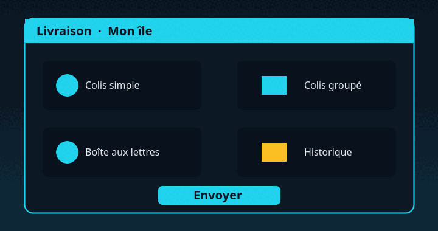

La **livraison** permet de faire parvenir des objets à un autre joueur, même s'il est hors ligne, sans vous déplacer
sur son île. Cette page explique comment préparer un colis, ce qu'il coûte et que faire s'il n'arrive pas.

> [!NOTE]
> Cette page est un exemple : les commandes, prix et limites qu'elle cite sont fictifs. Elle montre toutes les mises
> en forme du wiki, à reprendre dans vos propres pages.

## Comment ça marche

Chaque île possède une **boîte aux lettres**, placée à côté du coffre de départ. Quand quelqu'un vous livre un colis,
il atterrit dedans et vous recevez une notification au prochain passage sur votre île.

## Préparer un colis

1. Ouvrez le menu avec `/livraison`.
2. Choisissez **Colis simple** pour un seul destinataire, ou **Colis groupé** pour plusieurs.
3. Glissez les objets à envoyer dans la grille, jusqu'à **27 emplacements**.



### Choisir le destinataire

Tapez son pseudo exact dans le champ de recherche. La liste se filtre au fil de la saisie, et le destinataire apparaît
même s'il n'est pas connecté.

### Ajouter un message

Un petit mot de 140 caractères maximum peut accompagner le colis. Il s'affiche à l'ouverture de la boîte aux lettres.

## Envoyer un colis

Une fois la grille remplie, cliquez sur **Envoyer**. Les frais sont débités immédiatement.

> [!IMPORTANT]
> Le destinataire doit avoir créé son île pour recevoir un colis.

```text
/livraison
/livraison <joueur>
/livraison historique
```

> [!TIP]
> Avec `/livraison <joueur>`, vous ouvrez directement la grille pour ce destinataire.

## Frais et limites

| Type de colis | Emplacements | Frais | Délai |
| --- | --- | --- | --- |
| Simple | 27 | 50 Dreams | Instantané |
| Groupé (5 joueurs maximum) | 27 par joueur | 40 Dreams par joueur | Instantané |
| Ressources rares | 9 | 200 Dreams | 10 minutes |

Vous pouvez envoyer **20 colis par jour**[^limite]. La limite se réinitialise à 4 h du matin.

> [!WARNING]
> Les objets avec plus de trois enchantements ne peuvent pas être livrés.

> [!CAUTION]
> Un colis envoyé ne peut pas être annulé : vérifiez le pseudo avant de cliquer sur **Envoyer**.

## Avant d'envoyer

- [x] Le destinataire a une île.
- [x] Sa boîte aux lettres n'est pas pleine.
- [ ] Vous avez assez de Dreams pour les frais.

Pour ouvrir l'historique plus vite, appuyez sur <kbd>Maj</kbd> + clic droit sur la boîte aux lettres.

## En cas de problème

<details>
<summary>Le destinataire n'apparaît pas dans la liste</summary>

Vérifiez l'orthographe de son pseudo : les majuscules comptent. S'il vient de rejoindre le serveur, attendez sa
première connexion.

</details>

<details>
<summary>Les objets ont disparu</summary>

Ouvrez un ticket sur le [Discord One Dream](https://discord.gg/RjYBUUKYFg) avec la date et le pseudo du destinataire.
Retrouvez aussi le [squelette d'une page](modele-page.md#faire-etape-par-etape) pour écrire la vôtre.

</details>

[^limite]: Hors événements spéciaux, où la limite peut être relevée.
