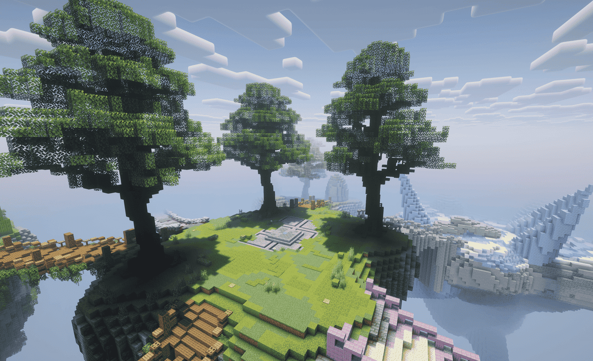
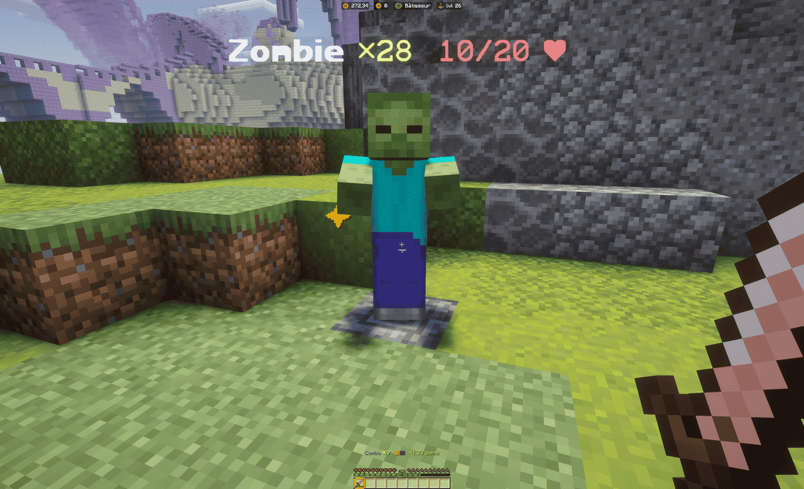
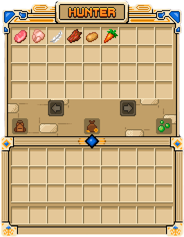

Sur votre île, aucun animal ni monstre n'apparaît : toute la chasse du serveur se joue sur
l'**île de chasse**, un monde dédié regroupant toutes les proies du jeu. Cette page explique
comment s'y rendre, comment y frapper efficacement et comment récupérer le butin de vos combats.
Pour la liste des zones et des mobs, voir [zones et monstres](zones-et-monstres.md).

## Rejoindre l'île de chasse

```text
/hunter          Rejoindre l'île de chasse
/skyblock        Retourner au spawn du monde principal
/is              Revenir sur votre île
```

Sur l'île, vous êtes en **mode aventure** : vous ne pouvez ni casser ni poser de blocs, et vous
ne pouvez pas y laisser tomber d'objets. Rien n'est à perdre : tout butin part directement dans
votre stockage.



### Chacun sa chasse

Les mobs de l'île sont propres à chaque joueur : **les autres joueurs ne peuvent pas voler vos
mobs**, et vous ne volez pas les leurs. Deux joueurs côte à côte voient chacun ses propres
animaux, au même endroit. Vous chassez à votre rythme, sans compétition.

### Se déplacer sur l'île

L'île est grande : des **plaques de pression** servent de tremplins pour sauter d'un bout à
l'autre. Marchez sur une plaque pour être propulsé en l'air vers une autre partie de l'île, sans
dégâts à la réception.

## Frapper efficacement

Frapper un mob, c'est frapper son **groupe** : un point de mob abrite un stack d'exemplaires du
même animal. Chaque coup retire des points de vie à celui de tête, et le surplus de dégâts se
reporte sur le suivant : un coup puissant peut donc en abattre plusieurs d'un seul coup.

### La charge d'attaque

Comme dans le combat Minecraft moderne, un coup porte trop tôt ne fait qu'une **petite partie de
ses dégâts**. Attendez que la jauge d'attaque sous le viseur soit pleine avant de frapper :
enchaîner les clics au hasard est bien moins rentable qu'un coup bien calé.

### Les coups critiques

Un coup porté **en chute**, à pleine charge et sans sprinter, est un **coup critique** : il fait
bien plus de dégâts. Sauter et frapper au moment de retomber est donc un réflexe à prendre.

### Le combo

Enchaînez vos coups **au bon rythme** : votre **combo** monte à chaque coup réussi dans le
rythme, et il monte encore plus vite si vous visez les **points faibles**, les zones lumineuses
qui se promènent sur le corps du mob. Plus le combo est élevé, plus **le butin et l'expérience
de chasse sont multipliés** — jamais les dégâts.




Le rythme à tenir **s'accélère** à mesure que le combo monte : la jauge d'attaque suit cette
accélération, suivez-la plutôt que votre mémoire. Un coup trop tard casse le combo, mais il
conserve ses dégâts : vous perdez le bonus, pas le coup. Une pause de quelques secondes remet
aussi le compteur à zéro.

> [!TIP]
> Si vous voulez viser juste : les points faibles font monter le combo, les critiques aussi, et
> les deux s'additionnent.

Certains mobs **esquivent** : après quelques coups encaissés, ils se déplacent d'un bond,
accompagné d'un son et de particules. Recadrez votre visée avant le coup suivant. Les premiers
animaux restent immobiles, les plus coriaces bougent de plus en plus.

## Le butin et le stockage

Le butin de vos combats ne remplit pas votre inventaire : il s'accumule dans votre **stockage de
chasse**.



```text
/hunter loots    Ouvrir le stockage de votre butin
```

Dans ce menu, vous pouvez :

- **Récupérer** vos objets dans votre inventaire, un type d'objet à la fois ;
- **Tout vendre** : ce qui est vendable à votre grade est converti en SkyCoins, le reste reste
  dans le stockage ;
- **Convertir votre expérience de chasse** en points d'expérience Minecraft, en choisissant la
  part à convertir.

Ce qui est vendable dépend de votre [SkyGrade](../progression/skygrades.md), comme pour la vente
classique : ouvrez le stockage, il affiche ce qui peut partir et ce qui reste.

## L'expérience du Chasseur

Chaque mob abattu fait gagner de l'expérience au métier **Chasseur** : plus la proie est
puissante, plus elle rapporte. C'est sur l'île de chasse que ce métier progresse, et ses niveaux
débloquent des outils comme les autres métiers. Voir [les métiers](../progression/metiers.md).

Vous gagnez aussi une **expérience de chasse** propre, visible dans le stockage : elle se
convertit en expérience Minecraft depuis le stockage.

> [!IMPORTANT]
> Vos kills de chasse comptent comme des kills classiques dans les statistiques du jeu, utilisées notamment par les
> SkyGrades et les succès. Un groupe de mobs abattu compte pour autant de kills individuels.

## Les mobs qui réapparaissent

Quand un point de mob est vidé, un hologramme affiche **« Réapparaît dans X s »** : le groupe se
reconstitue par paliers jusqu'à sa taille maximale. Le délai est affiché en jeu, inutile de
garder un œil ailleurs : revenez quand le compte est remis.
