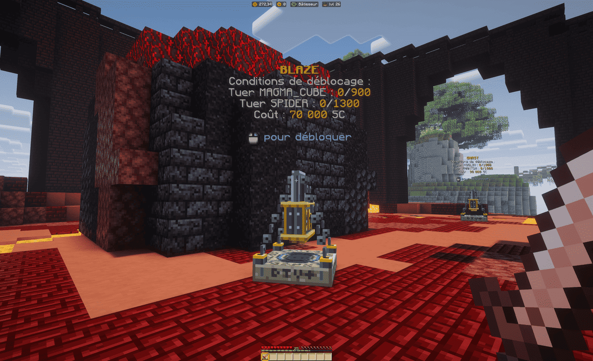
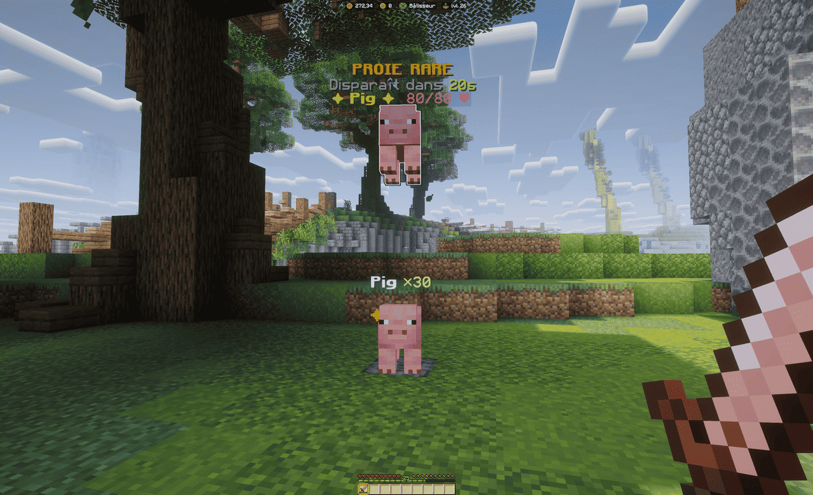

L'île de chasse est découpée en **zones**, de la ferme des débuts jusqu'aux mondes du Nether et
de l'End. Chaque zone regroupe des proies d'un même univers, de plus en plus résistantes et de plus en plus rentables. Cette page fait le tour des zones et explique comment débloquer les mobs
verrouillés. Le fonctionnement de l'île est détaillé dans [l'île de chasse](ile-de-chasse.md).

## Les zones

Vous commencez au milieu des animaux de la ferme : tout le reste est verrouillé et s'ouvre au fil
de votre progression.

| Zone | Mobs |
| --- | --- |
| Débutant | Cochon, Poule, Vache, Mouton, Lapin |
| Rurale | Chèvre, Tatou, Cheval, Panda, Ours polaire |
| Marais et utilitaires | Slime, Grenouille, Champimeuh, Tortue, Golem de fer |
| Aquatique et apiculture | Calmar, Calmar lumineux, Noyé, Abeille |
| Hostiles niveau 1 | Zombie, Squelette, Araignée, Creeper |
| Hostiles niveau 2 | Phantom, Gardien, Enderman, Sorcière |
| Boss et élite | Breeze, Évocateur, Gardien ancien, Squelette wither, Warden |
| Nether | Cube de magma, Piglin zombifié, Hoglin, Blaze, Ghast |
| End | Endermite, Shulker |

Un **Golem de neige** complète la liste : son déblocage ne passe pas par des éliminations, mais
par des objets à remettre, comme indiqué sur son verrou.

### Le butin par zone

Chaque zone a sa production : viandes et cuir côté animaux, os, poudre à canon et ficelle côté
hostiles, blocs et réactifs rares côté Nether et End. Les objets obtenus dépendent des mobs
chassés et des probabilités en jeu : consultez le mob ou votre stockage pour voir ce qu'une
proie vous a rapporté, plutôt que d'apprendre des listes par cœur.

## Débloquer un mob

Les mobs verrouillés sont gardés par un **verrou animé** : c'est le bloc mystérieux qui se dresse
à la place du mob. Les conditions de déblocage s'affichent en permanence au-dessus de lui :

- un montant en **SkyCoins**, payé une seule fois au déblocage ;
- un nombre d'**éliminations** des mobs précédents : le compteur ne se remet jamais à zéro, tout
  ce que vous tuez compte ;
- parfois des **objets** à remettre, retirés de votre inventaire au déblocage.

Quand toutes les conditions sont remplies, faites un **clic droit** dessus pour
le débloquer. Si vous cliquez alors qu'une condition manque, le verrou le refuse et vous montre
ce qu'il reste à faire.

> [!TIP]
> Les éliminations exigées portent souvent sur des mobs déjà à portée : chassez ce que vous avez
> sous la main, les compteurs avancent tout seuls vers le verrou suivant.

## Les proies rares

De temps en temps, une **proie rare** apparaît sur l'île, uniquement pour vous : une version
surdimensionnée d'un mob que vous avez débloqué, qui flotte et brille, et qui reste là un temps
limité. Elle apparaît loin de vous : traversez l'île pour l'atteindre, les tremplins servent
aussi à ça.

L'abattre rapporte un **gros bonus**, annoncé par un message qui dit exactement ce qu'il fait :
butin immédiat multiplié, gains de chasse multipliés pendant un court instant, combo porté au
maximum, stacks remplis d'un coup… Si vous n'arrivez pas à la tuer à temps, elle s'échappe sans
conséquence.

> [!IMPORTANT]
> Une proie rare apparaît seulement pendant que vous êtes sur l'île : le compte à rebours ne
> s'écoule pas en votre absence. Les proies rares n'existent que sur l'île de chasse.
