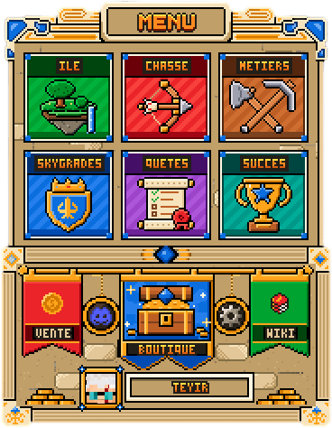
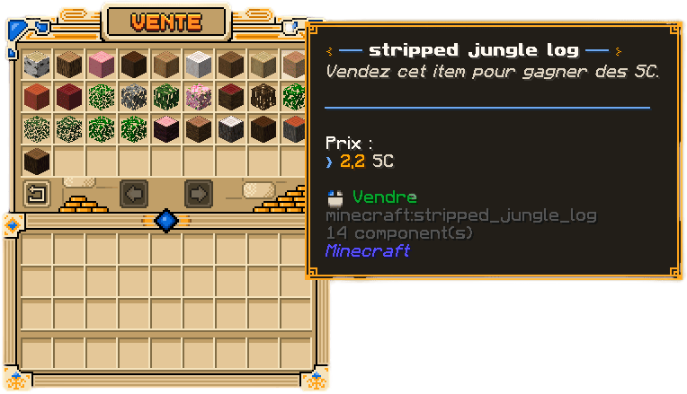
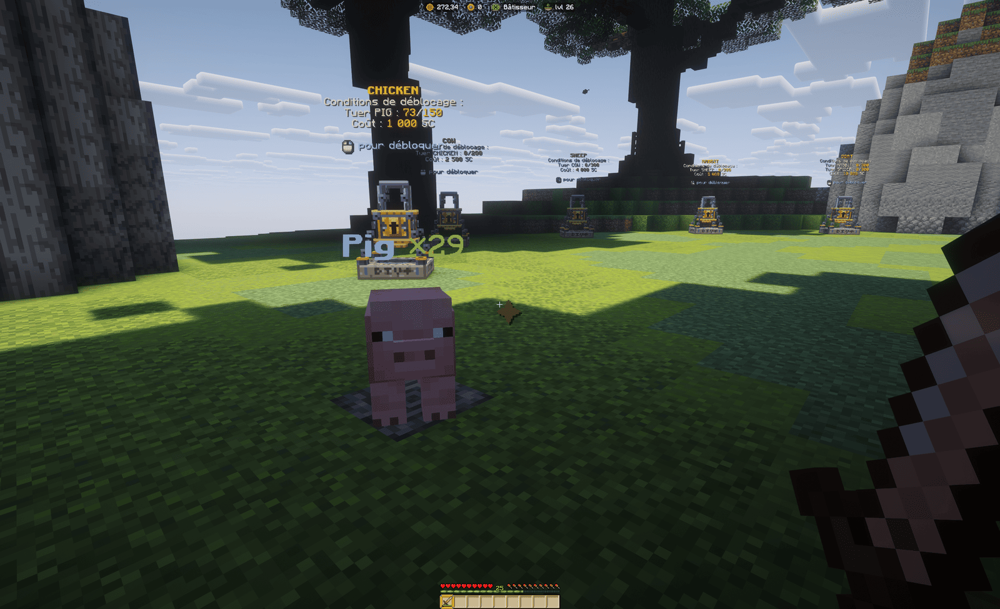

Vous venez de créer votre île ? Cette page décrit le parcours conseillé pour les premières heures : où trouver les
menus, comment gagner vos premiers SkyCoins et dans quel ordre débloquer les systèmes du serveur.

## Le parcours conseillé

- [ ] Ouvrir le menu principal avec `/menu` pour repérer les boutons.
- [ ] Faire le tour de votre île et ouvrir le coffre de départ.
- [ ] Ramasser du bois et de la pierre, puis fabriquer vos premiers outils.
- [ ] Valider le grade **Roturier** avec `/sg`, qui débloque la vente.
- [ ] Vendre vos récoltes avec `/sell` pour obtenir vos premiers SkyCoins.
- [ ] Rejoindre un métier avec `/jobs` et viser vos premiers outils spéciaux.
- [ ] Découvrir l'île de chasse avec `/hunter`.
- [ ] Regarder vos quêtes journalières avec `/dailyquests`.

## Le menu principal

La commande `/menu` ouvre le menu du serveur. Chaque bouton renvoie à un système, sans retenir de commande. Survolez
une carte pour voir votre progression : niveau de l'île, mobs débloqués, grade actuel, succès obtenus.



| Bouton | Ce que ça ouvre |
| --- | --- |
| **Île** | Le panneau de contrôle de votre île |
| **Chasse** | La téléportation sur l'île de chasse |
| **Métiers** | Le menu des métiers |
| **SkyGrades** | Votre progression en grades |
| **Quêtes** | Les quêtes journalières |
| **Succès** | Le menu des succès |
| **Vente** | Le menu de vente `/sell` |
| **Boutique** | La boutique du serveur, avec le cadeau du jour |
| **Wiki** et **Discord** | Les liens officiels, affichés dans le chat |
| **Options** (roue dentée) | Vos réglages de jeu |
| **Votre tête et votre pseudo** | Votre profil |

### Votre profil

Cliquez sur votre tête ou sur votre pseudo, en bas du menu, pour ouvrir votre **profil**. Il réunit toutes vos
données en un coup d'œil : grade, titre, solde, temps de jeu, niveaux de métiers, statistiques de chasse, de votre île
et des animations, boosts actifs et position dans les classements. Le profil sert à consulter : rien ne s'y modifie.

### La boutique

Le bouton **Boutique**, comme la commande `/boutique`, ouvre la boutique en jeu. Vous y trouvez :

- le **cadeau du jour** : un objet gratuit, différent chaque jour, à récupérer une fois par jour ;
- l'**abonnement** ;
- les **clés** de caisse, payées en Tokens.

### Les options

La roue dentée ouvre vos **options**, aussi accessibles depuis le profil. Un clic sur un réglage l'active ou le
coupe :

- **Sons du bûcheronnage** : les sons de l'arbre abattu d'un coup, de l'effet Twerk et du ramassage ;
- **Joueurs sur l'île de chasse** : afficher ou masquer les autres chasseurs.

## Monter en SkyGrade

Les **SkyGrades** sont la progression principale : chaque grade demande des ressources à fournir et des actions à
réaliser, et en retour débloque des avantages. Ouvrez le menu avec `/sg` pour voir le grade à valider et son
contenu.

Le premier grade, **Roturier**, se prépare dès la première heure : collectez vos bûches et votre pierre, et suivez
les objectifs affichés dans le menu. Il vous donne notamment l'accès à la commande `/sell`,
indispensable pour la suite.

```text
/sg
```

Pour le détail des grades, des paliers et des récompenses, consultez [la page SkyGrades](../progression/skygrades.md).

## Gagner vos premiers SkyCoins

Une fois le grade Roturier validé, vendez vos surplus avec `/sell` :



```text
/sell
```

Le menu de vente affiche, pour chaque objet, s'il est vendable et à quel prix. Ce que vous pouvez vendre dépend de
votre grade : les groupes d'objets vendables se débloquent au fil de votre progression.

Gardez un double de chaque ressource essentielle : les quêtes, les grades et les métiers demandent régulièrement
des matériaux à fournir.

La vente reste votre principale source de revenus : les métiers, eux, ne rapportent pas de SkyCoins.

## Rejoindre un métier

Avec `/jobs`, choisissez l'un des métiers du serveur : **Bûcheron**, **Fermier**, **Mineur** ou **Chasseur**.
Chaque métier gagne de l'expérience dans son activité : couper du bois, récolter, miner ou chasser.

```text
/jobs
```

> [!IMPORTANT]
> Les métiers ne rapportent **pas d'argent** : ils donnent uniquement de l'expérience. Leurs niveaux débloquent des
> outils et des avantages, et comptent pour vos SkyGrades.

Par défaut, vous exercez **un seul métier à la fois**. Le nombre de métiers simultanés s'améliore ensuite avec votre
progression. Vous pouvez changer de métier quand vous le souhaitez : **vous ne perdez pas votre progression**, et vous
la retrouvez intacte en revenant à l'ancien métier.

Détails et paliers : [les métiers](../progression/metiers.md) et [les outils](../progression/outils.md).

## L'île de chasse

Les animaux et les monstres **n'apparaissent pas sur les îles**. Pour chasser, rendez-vous sur l'**île de chasse** :
c'est là que se trouvent tous les animaux et les monstres du serveur, et c'est là que le métier de Chasseur gagne son
expérience.

```text
/hunter          Rejoindre l'île de chasse
/hunter loots    Ouvrir le stockage de votre butin
/is              Revenir sur son île
```

L'île est découpée en zones, des animaux de la ferme jusqu'aux créatures du Nether et de l'End. Au départ, seuls les
premiers mobs sont disponibles : les autres sont verrouillés. Les conditions de déblocage s'affichent au-dessus de
chaque mob verrouillé : des SkyCoins et un nombre d'éliminations du mob précédent. Une fois les conditions réunies,
faites un clic droit dessus pour le débloquer.




Le butin de vos combats ne remplit pas votre inventaire : il s'accumule dans votre **stockage**. Ouvrez-le avec
`/hunter loots` pour récupérer vos objets ou vendre ce qui est vendable à votre grade.

> [!TIP]
> Enchaînez les coups au bon rythme pour faire monter votre **combo** : plus il est élevé, plus la chasse rapporte.

Tout le détail : [l'île de chasse](../chasse/ile-de-chasse.md) et [ses zones et monstres](../chasse/zones-et-monstres.md).

## Les quêtes journalières

Chaque jour, un lot de quêtes est proposé : vendre des objets, casser des blocs, récolter des cultures… La plupart
se réalisent naturellement pendant que vous jouez. Ouvrez le menu avec `/dailyquests` (ou `/dq`) pour suivre votre
progression et récupérer vos récompenses.

```text
/dailyquests
```

Elles se réinitialisent chaque jour. Voir [la page des quêtes journalières](../progression/quetes-journalieres.md).

## Les succès

Les **succès** récompensent les actions marquantes de votre progression. Consultez-les avec `/succes` pour voir ce
qui est attendu et ce qu'ils rapportent. Certains demandent du temps, d'autres se valident tout seuls en jouant.

```text
/succes
```

Voir [la page des succès](../progression/succes.md).

## Et ensuite

Une fois ces bases posées, votre rythme est simple : jouer, vendre, valider le grade suivant, refaire les quêtes du
jour. Au fil de vos grades, la vente, les améliorations d'île et les outils de métier s'ouvrent les uns après les
autres.

Pour retrouver toutes les commandes joueur en un coup d'œil, consultez [la liste des commandes](../commandes.md).
