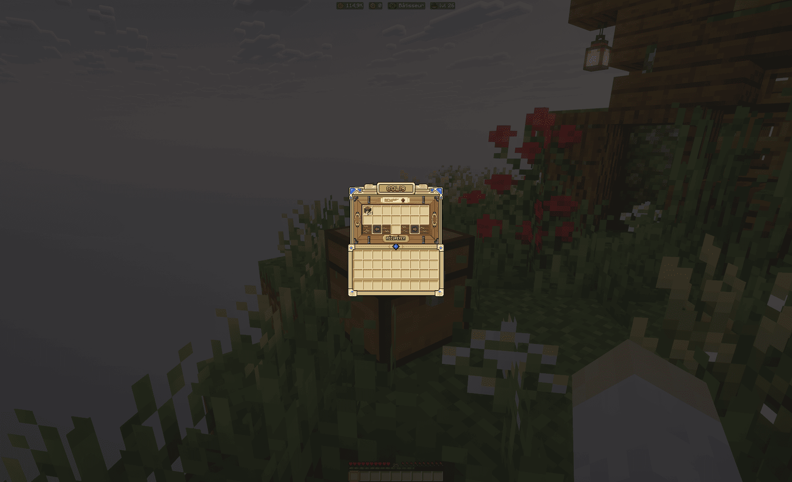

Au spawn, huit marchands vous vendent des matériaux difficiles à obtenir autrement : blocs du Nether, pierre de
l'End, béton, fleurs et bien plus. Les achats se paient en **SkyCoins**, la monnaie du jeu. Cette page explique comment acheter sur place, comment la livraison sur votre île se débloque, et ce
que coûtent les frais de port.

## Les boutiques du spawn

Chaque marchand tient un comptoir et se spécialise dans un rayon : Antonio vend les roches et pierres de profondeur,
Bobby les matériaux de l'End, Charlotte les fleurs et plantes ornementales, Jack les blocs du Nether, Jimmy les
herbes, mousses et coraux, Margaux la glace et la prismarine, Pierre le béton de toutes les couleurs, et Tom la
terre, le sable et les sédiments.

Pour acheter, cliquez sur le marchand : son catalogue s'ouvre, avec le prix de chaque article et la quantité de votre
choix. Un achat se paie en SkyCoins ; certains articles demandent aussi des objets en supplément.

1. Ouvrez le comptoir et choisissez l'article.
2. Réglez la quantité, puis confirmez.
3. Les objets arrivent dans votre inventaire, avec débordement dans votre sac. S'il n'y a la place ni
   pour l'un ni pour l'autre, l'achat est refusé avant paiement ; la part qui ne rentre finalement pas est
   remboursée.

> [!NOTE]
> Bobby, le marchand de l'End, est le seul à refuser de commercer avec vous au départ : il faut lui payer l'ouverture
> de son commerce pour accéder à son comptoir.

## Les paliers et contrats

Chaque marchand suit votre progression chez lui :

- **Les paliers** mesurent le nombre d'objets que vous lui avez achetés. Chaque palier franchi vous rapporte des
  récompenses (clés de caisse, ReRolls…) ; le menu du marchand affiche votre progression et les paliers à venir.
- **Le contrat** : l'un des paliers rend disponible le contrat du marchand, une petite quête non répétable.
  Revenez le voir pour l'accepter : il vous indique un point du spawn à trouver, signalé par des particules et un
  indice. Un contrat rempli, vous débloquez la livraison.

> [!IMPORTANT]
> Le détail des contrats est encore en cours de réglage par le staff : les conditions et les récompenses peuvent
> évoluer. Le menu du marchand affiche toujours la situation à jour.

## Recevoir vos livraisons

Une fois le contrat rempli, le catalogue du marchand devient livrable : vous pouvez commander des quantités plus
importantes et vous les faire livrer directement sur votre île.

Ouvrez le menu avec `/livraison` (les alias `/livraisons`, `/delivery` et `/deliveries` fonctionnent aussi), comme
indiqué dans [la liste des commandes](../commandes.md).

1. Ouvrez `/livraison` et choisissez le marchand.
2. Réglez la quantité, puis validez : vous devez être sur votre île, et une seule livraison peut être en route à la
   fois.
3. Le colis tombe du ciel à l'endroit où vous vous trouviez lors de la commande, puis reste posé au sol quelques
   minutes.
4. Cliquez sur le colis pour l'ouvrir, puis sur **Récupérer** : son contenu se verse dans votre sac. Si le sac
   déborde, le reliquat reste dans le colis.

Un colis non récupéré avant sa disparition ne se perd pas : son contenu rejoint l'onglet **Colis en attente** du menu
`/livraison`, et vous êtes prévenu à votre prochaine connexion.

### Les frais de livraison

Une commande livrée coûte le prix du comptoir, plus des frais de port prélevés sur la part en SkyCoins de la
commande. Ces frais sont offerts aux joueurs abonnés : leur écran de commande l'indique directement, et un encart
renvoie vers `/boutique` pour les autres.

## En cas de problème

- **« Une livraison est déjà en route »** : attendez la réception du colis en cours avant d'en commander un autre.
- **Des objets manquent après un achat** : la part non livrée est remboursée ou déposée dans l'onglet **Colis en
  attente** de `/livraison`.
- **Un colis ne s'ouvre pas** : si un incident est enregistré, ouvrez un ticket sur le
  [Discord One Dream](https://discord.gg/RjYBUUKYFg) avec la date de la commande.
