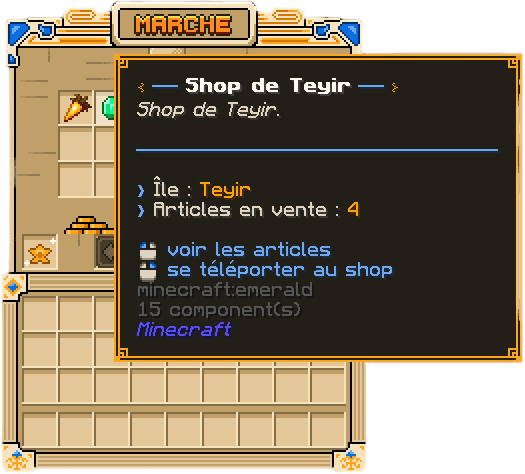
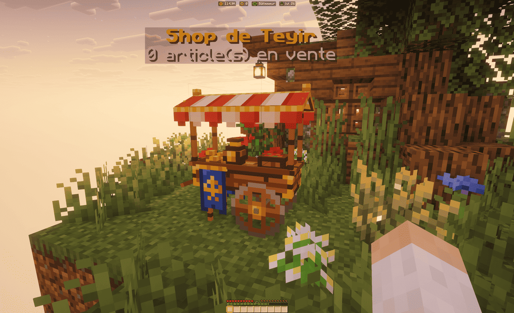
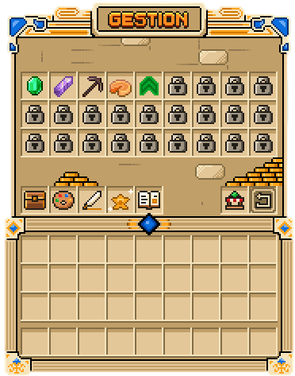

Le commerce entre joueurs se fait grâce aux **shops** : des étals posés sur les îles, où chaque joueur vend ce qu'il
veut au prix qu'il fixe. Cette page explique comment trouver un shop, comment poser et gérer le vôtre, et comment
récupérer vos gains.

## Trouver un shop

L'annuaire s'ouvre avec `/ah` (les alias `/hdv`, `/shops` et `/trade` fonctionnent aussi). Il liste les shops posés
par les joueurs ; certains articles sont **mis en avant** et apparaissent en tête d'annuaire. Depuis l'annuaire,
téléportez-vous au shop choisi : vous arrivez sur l'île du vendeur. Une île qui n'accepte pas de visiteurs refuse
également les achats.

Sur place, chaque shop porte un nom flottant qui indique son nom et son nombre d'articles. Cliquez sur l'étal,
choisissez un article et la quantité : le paiement se fait en SkyCoins, ou en objets si le vendeur a choisi le troc.
Les objets à interdiction de commerce sont refusés à la vente, et un conteneur qui en contient un l'est aussi.

## Obtenir et poser votre shop

Un shop s'obtient comme récompense : l'un des [SkyGrades](../progression/skygrades.md) en offre un. Les shops reçus
sont d'abord rangés : le message de récompense vous l'annonce.

Pour le poser :

1. Rendez-vous sur votre île et ouvrez `/ah place`.
2. Choisissez le shop rangé à poser, puis regardez le bloc qui doit l'accueillir, à quelques blocs de distance.
3. Confirmez : l'étal apparaît, nommé par défaut « Shop de <votre pseudo> ». Cliquez dessus pour le gérer.

Seul un joueur autorisé à construire sur l'île peut y poser un shop, et l'île a une **limite de shops** : un seul au
départ, améliorable jusqu'à cinq depuis le menu **Mes shops**.

### Gérer vos articles

Ouvrez votre shop pour accéder à sa gestion :

- **Ajouter un article** : tenez en main l'objet à vendre, cliquez sur un emplacement libre, puis fixez le prix
  d'une unité dans le chat — en SkyCoins, ou en objets pour le troc. Ajoutez ensuite le stock depuis votre
  inventaire ou votre sac.
- **Emplacements** : un shop démarre avec **3 emplacements** et peut monter jusqu'à **27**. Chaque emplacement
  supplémentaire se débloque dans l'ordre, contre des SkyCoins et des matériaux qui augmentent d'un rang à l'autre.
- **Renommer, retirer un article, ajuster le stock** : tout se fait depuis le menu de gestion. Un article sans prix
  ne part pas en vente.

## Vos gains

Quand un article se vend, vous recevez une notification, et les ventes rapprochées sont regroupées en un seul
message. L'argent va directement à **la banque de votre île** ; les paiements en objets rejoignent le **stockage du
shop**, d'où vous les récupérez. Aucune commission n'est prélevée sur la vente. L'historique du shop liste les
ventes récentes, et un résumé vous attend à votre connexion si vous avez vendu pendant votre absence.

Si des objets n'ont pas pu vous être remis (inventaire et sac pleins), ils attendent dans votre **boîte de
récupération**, ouverte avec `/ah recup`.

Pour ranger un shop, videz d'abord le stock de tous ses articles et son stockage : vous le récupérez avec ses
améliorations, prêt à être reposé ailleurs.

## Skins et mises en avant

- **Skins** : votre shop prend l'apparence d'un étal visible par tous. Des skins d'apparence (charriot marchand,
  noble, royal…) peuvent se débloquer ou s'acheter avec des SkyCoins ou des Tokens ; un skin débloqué s'applique à
  tous vos shops.
- **Mise en avant** : depuis la gestion du shop, mettez un article en vente en tête de l'annuaire pendant une
  demi-heure. Un seul article par île à la fois, contre des émeraudes.

> [!TIP]
> Pour attirer les acheteurs, gardez un stock visible et un nom clair : un article en rupture de stock vous est
> signalé, mais n'attire plus personne.

## En cas de problème

Vous n'avez plus la place pour vos achats

Ouvrez `/ah recup` : les objets que l'achat n'a pas pu vous remettre y attendent.

Votre shop a disparu de l'île

S'il a été retiré (reset d'île, expulsion), son contenu vous a été rendu : vérifiez votre boîte de récupération avec
`/ah recup`, puis reposez-le avec `/ah place`.

