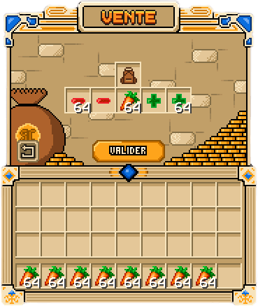

La commande `/sell` est le principal moyen de gagner des [SkyCoins](monnaies.md) : vous y vendez vos
récoltes, vos minerais, votre bois et toutes vos ressources. Cette page explique comment vendre, quels
objets sont vendables et comment augmenter vos revenus.

## Vendre avec /sell

Tapez `/sell` (alias `/s`, `/vendre`, `/vente`) pour ouvrir le menu de vente. Les objets vendables y
sont classés par groupes : pierre, bois, cultures, plantes, nourriture, mobs, minerais, nether et
divers. Sélectionnez ce que vous voulez céder, vérifiez le total, puis confirmez : les SkyCoins sont
crédités immédiatement et les objets sont retirés de votre inventaire ou de votre
[sac](sac.md).



L'accès à `/sell` est la récompense du premier [SkyGrade](../progression/skygrades.md) : vous débloquez
la vente dès vos premiers pas sur l'île.

Des modes avancés existent :

```text
/sell hand
/sell all
```

- `/sell hand` vend l'objet tenu en main.
- `/sell all` vend d'un coup tous les objets vendables de votre inventaire.

Ces deux modes sont réservés aux abonnés.

## Les prix de vente

Chaque objet a un prix de base, et seuls les objets débloqués par votre
[SkyGrade](../progression/skygrades.md) peuvent être vendus : plus vous montez de grades, plus le
catalogue s'élargit.

Le prix de vente augmente ensuite avec votre grade : vendre un objet débloqué depuis longtemps rapporte
plus que lorsqu'il vient d'être débloqué. En clair, progresser dans les SkyGrades rend vos récoltes plus
rentables, même aux prix inchangés. Les valeurs à jour (prix de chaque objet, paliers) s'affichent dans
le menu `/sell` : ne vous fiez pas à des listes figées.

### Le SG Weekly

Le **SG Weekly** est un marché au spawn : chaque semaine, une petite sélection d'objets y est proposée à
un prix nettement plus avantageux, avec un quota de ventes par joueur et par objet pour la semaine.
C'est le meilleur endroit pour écouler en priorité les objets proposés. Il est ouvert à tous, accessible
en parlant au PNJ du spawn ou avec `/sg weekly` ; la sélection change chaque semaine. Les détails sont
dans la page [SkyGrades](../progression/skygrades.md).

## Les boosts de vente

Certains effets multiplicateurs augmentent temporairement vos revenus de vente :

- les **boosts de vente**, activés avec `/boost` (voir [les boosts](boosts.md)) ;
- les **Bâtons de Vente**, des [outils](../progression/outils.md) qui vendent tout le contenu d'un
  coffre d'un clic droit, avec leur propre multiplicateur cumulé aux boosts de vente.

> [!TIP]
> Cumulez : activez un boost de vente, puis videz vos coffres avec un Bâton de Vente. C'est la façon la
> plus rentable de vendre un gros stock.
