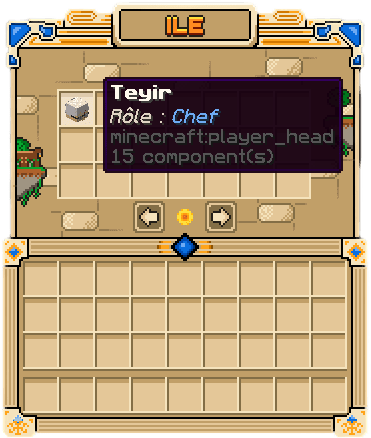
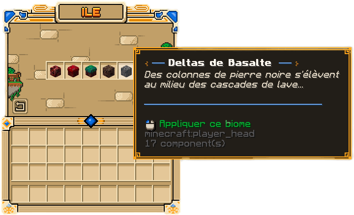
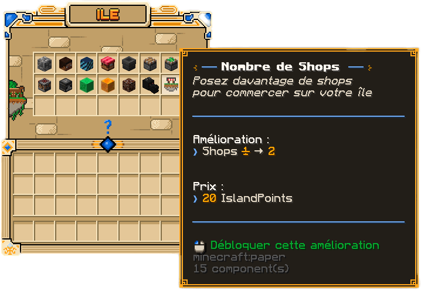

Votre île se partage, se règle et s'agrandit. Cette page s'adresse aux joueurs qui ont déjà
[créé leur île](../debuter/creer-son-ile.md) : elle explique comment jouer à plusieurs, protéger votre île et la
faire progresser. Presque tout se fait depuis le panneau de contrôle, ouvert avec `/is menu`.

## Inviter et retirer des membres

Les membres partagent l'île, ses ressources et sa progression : les [missions d'île](missions-d-ile.md) et les
IslandPoints sont communs à toute l'équipe.

```text
/is invite <joueur>    Inviter un joueur sur votre île
/is accept <joueur>    Accepter une invitation reçue
/is members            Ouvrir le menu des membres
/is kick <joueur>      Retirer un membre de l'île
/is leave              Quitter l'île dont vous êtes membre
```

Une île accueille **4 membres** au départ, et jusqu'à **8** avec l'amélioration Limite de Membres. Vous ne pouvez
appartenir qu'à une seule île : pour en rejoindre une autre, quittez d'abord la vôtre.




Le chef peut céder sa place avec `/is transfer <joueur>`, ou supprimer l'île avec `/is disband`. Chaque action
sensible demande une confirmation.

> [!WARNING]
> Une île supprimée ne se récupère pas, et le nombre de suppressions d'île par joueur est limité. Videz vos coffres et
> votre banque d'île avant de confirmer.

### Les coopérateurs

Un **coopérateur** peut construire et récolter sur votre île sans en devenir membre. C'est pratique pour un coup de
main ponctuel.

```text
/is coop <joueur>      Ajouter un coopérateur
/is uncoop <joueur>    Retirer un coopérateur
/is coops              Ouvrir la liste des coopérateurs
```

## Les rôles et permissions

Chaque joueur présent sur votre île a un **rôle**, du moins au plus élevé :

| Rôle | Qui ? |
| --- | --- |
| **Visiteur** | Un joueur extérieur à l'île |
| **Coop** | Un coopérateur |
| **Membre** | Le rôle de départ d'un nouveau membre |
| **Modérateur** | Un membre promu |
| **Admin** | Le bras droit du chef |
| **Chef** | Le propriétaire de l'île |

Promouvez ou rétrogradez un membre depuis le menu des membres, ou avec les commandes :

```text
/is promote <joueur>
/is demote <joueur>
```

Le menu **Permissions de l'Ile** (`/is permissions`) règle ce que chaque rôle peut faire : casser, poser, ouvrir les
coffres, utiliser les portes, inviter, gérer la banque… Vous pouvez aussi accorder une permission à un joueur précis.

## Accueillir des visiteurs

Les autres joueurs visitent votre île avec `/is visit <joueur>`. Pour les accueillir, posez un **panneau de
bienvenue** : écrivez `[Welcome]` sur la première ligne d'un panneau. Il affiche alors « Bienvenue », et les
visiteurs arrivent devant lui. Les lignes suivantes servent de description à votre île.

```text
/is open               Ouvrir votre île au public
/is close              Fermer votre île au public
/is expel <joueur>     Faire sortir un visiteur
/is ban <joueur>       Bannir un joueur de votre île
/is unban <joueur>     Lever un bannissement
```

Les visiteurs ne subissent aucun dégât sur votre île, et ils ne peuvent rien y modifier sauf si vous leur en donnez la
permission.

## Les réglages de l'île

Le menu **Réglages de l'Ile** (`/is settings`) active ou coupe les règles de votre île d'un clic. Vous y réglez
notamment :

- le **temps** : jour, midi, nuit ou minuit permanent ;
- la **météo** : pluie permanente ou ciel dégagé ;
- les **dégâts** : explosions de creeper et de TNT, boules de feu de Ghast, propagation du feu, vandalisme des
  Endermen ;
- la **nature** : pousse des cultures, ponte d'œufs, écoulement de la lave ;
- le **PvP** sur votre île.

### Le biome

Changez le biome de votre île depuis le bouton **Biome de l'Ile** du panneau, ou avec `/is biome`.

Une fois le Nether débloqué (voir plus bas), votre île du Nether a son propre biome. Ouvrez son menu avec
`/is nether` et choisissez parmi Nether Wastes, Forêt Cramoisie, Forêt Vermoisie, Vallée des Âmes et Deltas de
Basalte. Un délai s'applique entre deux changements.




## Améliorer votre île

Le menu **Améliorations de l'Ile** (`/is upgrades`) fait progresser toute l'île. Chaque niveau se paie en
**IslandPoints**, gagnés avec les [missions d'île](missions-d-ile.md), et parfois en objets à fournir. Le menu affiche
le coût et l'effet de chaque niveau.




| Amélioration | Effet |
| --- | --- |
| **Générateur** | Votre générateur à pierre produit de plus en plus de minerais, jusqu'au diamant et à l'émeraude |
| **Taille de l'Île** | Agrandit la surface constructible, jusqu'à 400 × 400 blocs |
| **Limite de Membres** | Accueille plus de membres |
| **Nombre de Warps** | Crée plus de points de téléportation sur l'île |
| **Limites de blocs** | Pose plus d'entonnoirs, pistons, pistons collants, crafteurs, observateurs, blocs de slime et blocs de miel |
| **Accès au Nether** | Débloque l'île du Nether de votre équipe |
| **Nombre de Shops** | Pose plus de [shops joueurs](../economie/shops-joueurs.md) sur l'île |

Survolez le générateur dans le menu pour voir les minerais produits à chaque niveau.

### Les warps

Un warp est un point de téléportation que vous créez sur votre île, pour vous et pour vos visiteurs.

```text
/is setwarp <nom>      Créer un warp à votre position
/is warps              Ouvrir la liste des warps
/is delwarp <nom>      Supprimer un warp
```

## La banque et le classement

La **banque de l'île** est un coffre-fort commun en SkyCoins. Déposez-y de l'argent pour l'équipe avec le bouton
**Banque de l'Ile** ou `/is bank`. Ce que les membres peuvent retirer dépend de leurs permissions.

Le **classement des îles** (`/is top`) compare les îles selon leur niveau. Le niveau monte avec la valeur des blocs
posés sur l'île : plus vous construisez avec des blocs précieux, plus il grimpe.
