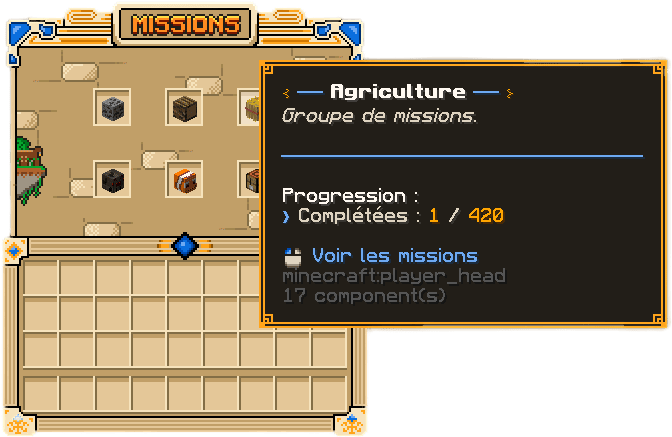
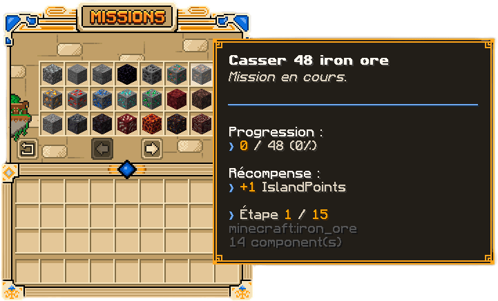

Les **missions d'île** récompensent tout ce que votre équipe fait au quotidien : miner, couper du bois, cultiver,
chasser, pêcher, fabriquer. Elles rapportent des **IslandPoints**, la monnaie qui finance les améliorations de votre
île. Cette page explique comment elles avancent et comment en tirer le meilleur.

## Comment fonctionnent les missions

Ouvrez le menu des missions avec :

```text
/missions
```

Les alias `/m` et `/mission` fonctionnent aussi. Les missions sont rangées en six groupes :



| Groupe | Ce qui compte |
| --- | --- |
| **Minage** | Casser de la pierre, des minerais et des blocs du Nether |
| **Bûcheronnage** | Couper des bûches, des feuilles, des tiges du Nether et des blocs de champignon |
| **Agriculture** | Récolter vos cultures et fabriquer des plats |
| **Chasse** | Tuer des mobs sur l'[île de chasse](../chasse/ile-de-chasse.md) |
| **Pêche** | Pêcher des poissons et des trésors |
| **Crafting** | Fabriquer n'importe quel objet |

Chaque mission suit une action précise, par exemple « Casser de la pierre » ou « Tuer des zombies ». Vous n'avez rien
à activer : la progression avance toute seule pendant que vous jouez.

### Une progression commune

Les missions appartiennent à l'**île**, pas au joueur. Chaque membre fait avancer les mêmes compteurs : à plusieurs,
les missions avancent bien plus vite.

Les missions de Minage, de Bûcheronnage et d'Agriculture ne comptent que sur **votre île**. Celles de Chasse, de
Pêche et de Crafting comptent partout.

### Les étapes

Chaque mission se découpe en **étapes**. Une étape terminée vous récompense aussitôt, puis la mission passe à
la suivante, avec un objectif plus élevé. Une même mission vous accompagne ainsi du début de partie jusqu'à la fin.



## Les IslandPoints

Chaque étape terminée crédite des **IslandPoints** à votre île. Les premières étapes d'une mission en rapportent peu,
les dernières en rapportent nettement plus.

Les IslandPoints appartiennent à l'île : ils ne s'échangent pas entre joueurs et restent à l'île si un membre part.
Consultez votre solde avec :

```text
/islandpoints
/islandpoints top
```

La seconde commande affiche le classement des îles. Votre solde apparaît aussi dans `/balances`, avec vos autres
[monnaies](../economie/monnaies.md).

## Les récompenses

Les IslandPoints se dépensent dans les **améliorations de l'île** : générateur, taille de l'île, nombre de membres,
warps, limites de blocs, accès au Nether et nombre de shops. Le détail est sur la page
[Gérer son île](gerer-son-ile.md).

> [!TIP]
> Variez les activités : chaque mission démarre avec une première étape facile. Toucher à tous les groupes rapporte
> vite vos premiers IslandPoints.
