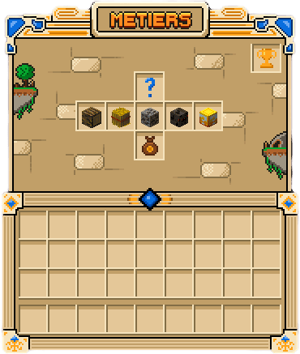

Les **métiers** font monter votre niveau de manière continue en jouant normalement : couper du bois, cultiver,
extraire des minerais ou chasser. Les niveaux obtenus débloquent des outils exclusifs et comptent pour les SkyGrades.
Cette page explique comment rejoindre un métier et gagner de l'expérience.

> [!IMPORTANT]
> Les métiers ne rapportent **pas d'argent** : ils font uniquement gagner de l'expérience. Pour la monnaie, passez
> par la vente de vos récoltes avec `/sell` (voir [les SkyGrades](skygrades.md)).

## Les quatre métiers

Ouvrez le menu des métiers avec `/jobs`. Vous y trouvez quatre métiers :

- **Bûcheron** : vous gagnez de l'expérience en coupant du bois.
- **Fermier** : vous gagnez de l'expérience en cultivant.
- **Mineur** : vous gagnez de l'expérience en extrayant des minerais.
- **Chasseur** : vous gagnez de l'expérience en chassant les mobs sur l'île de chasse (`/hunter`), car aucun animal
  ni monstre n'apparaît sur les îles.

Cliquez sur un métier pour le **rejoindre** ; cliquez à nouveau pour le **quitter**. Quitter un métier ne vous fait
pas perdre votre progression : vous retrouvez votre niveau en le rejoignant de nouveau. Un emplacement supplémentaire
du menu est réservé à un futur métier, et un bouton **Classement** arrive prochainement.

Le menu donne aussi accès au **Jobs Shop**, la boutique où vos niveaux débloquent gratuitement des outils et des
avantages. Tout y est détaillé dans [la page des outils](outils.md).

## Gagner de l'expérience

Chaque métier a son propre niveau, de 1 à **100**. L'expérience vient des actions du jeu :

- **Bûcheron** : couper des bûches et des feuilles, écorcer les bûches avec des cisailles. Plus le bois est rare
  (acajou, chêne pâle, palétuvier), plus il rapporte.
- **Fermier** : récolter des cultures, labourer et planter.
- **Mineur** : extraire de la pierre et des minerais ; les minerais des profondeurs rapportent plus que la pierre
  ordinaire.
- **Chasseur** : éliminer des mobs sur l'île de chasse ; les mobs dangereux rapportent plus.

> [!WARNING]
> Poser un bloc puis le casser ne rapporte rien : poser des bûches et certaines récoltes retire de l'expérience.
> Travaillez sur des arbres et des cultures qui poussent naturellement.

Votre **niveau global de métiers** est la somme des niveaux de vos métiers. Il débloque des paliers dans le Jobs Shop
et sert de condition pour plusieurs SkyGrades. Au début, vous ne pouvez exercer qu'un seul métier à la fois ; la
possibilité d'en cumuler se débloque dans la boutique (voir [les outils](outils.md)).

## Les déblocages par niveau

Chaque palier de 10 niveaux environ correspond à une récompense dans la boutique du métier : outils améliorés,
effets permanents ou capacité spéciale. À titre d'exemple, le bûcheron obtient sa première hache améliorée au
niveau 10, le mineur sa première pioche au niveau 15.

Les niveaux servent donc à deux choses :

- **obtenir les outils et les avantages** dans la boutique des métiers ;
- **remplir les conditions des SkyGrades**, qui demandent un niveau global élevé dans les grades supérieurs.

Montez vos métiers dès les premiers jours : la progression est longue, et les outils qu'ils débloquent accélèrent
tout le reste.
