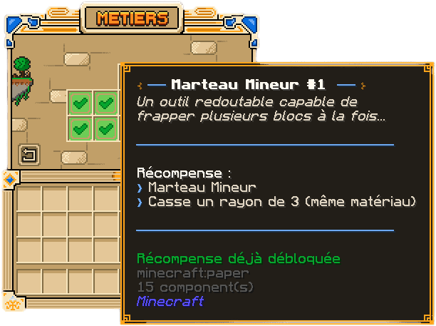

En plus des outils Minecraft classiques, One Dream propose des **outils améliorés** : incassables, fortement
enchantés, parfois capables de travailler une zone entière. Ils se débloquent dans la boutique des métiers grâce
à vos niveaux. Cette page liste ce que chaque métier débloque et ce que font ces outils.

## Obtenir un outil

Depuis le menu des métiers (`/jobs`), ouvrez le **Jobs Shop**. Deux boutiques y sont accessibles :

- la **boutique de votre métier** : dix paliers, environ tous les 10 niveaux de 10 à 100 ;
- la **boutique globale** : des paliers basés sur votre niveau total de métiers, avec le multi-outils et le cumul de
  plusieurs métiers simultanés.

Un palier se débloque d'un simple clic dès que le niveau requis est atteint : aucun achat, ni SkyCoins ni autre
monnaie. L'outil arrive directement dans votre inventaire.

> [!IMPORTANT]
> Chaque outil est un **objet personnel** : il ne peut pas être jeté au sol ni échangé. Vous pouvez uniquement le
> ranger dans votre sac (`/sac`).

## Les outils par métier

### Bûcheron

| Palier | Niveau requis | Récompense |
| --- | --- | --- |
| 1 | 10 | Hache en fer, Efficacité 3, Fortune 2, abat jusqu'à 20 bûches d'un coup |
| 2 | 20 | Abattage d'un arbre en un coup avec une hache de Bûcheron |
| 3 | 30 | Replantation automatique et ramassage des bûches dans l'inventaire, puis dans le sac |
| 4 | 40 | Hache en diamant, Efficacité 3, Fortune 2, abat jusqu'à 40 bûches d'un coup |
| 5 | 50 | Hache en diamant, Efficacité 5, Fortune 3, abat jusqu'à 70 bûches d'un coup |
| 6 | 60 | Effet « Twerk » : s'accroupir et se relever fait pousser les arbres alentour |
| 7 | 70 | Hache en netherite, Efficacité 8, Toucher de soie, abat jusqu'à 110 bûches d'un coup |
| 8 | 80 | Cisailles, Efficacité 5 |
| 9 | 90 | Hache en netherite, Efficacité 15, Toucher de soie, abat jusqu'à 160 bûches d'un coup |
| 10 | 100 | Cisailles, Efficacité 15 |

L'abattage en un coup s'active ou se coupe avec `/bucheron toggle` (alias `/timber toggle`). Pour casser une seule
bûche, accroupissez-vous. Les bûches abattues en plus de la première rapportent moins d'expérience de métier qu'une
bûche cassée à la main.

### Fermier

| Palier | Niveau requis | Récompense |
| --- | --- | --- |
| 1 | 10 | Houe en diamant, Fortune 2 |
| 2 | 20 | Houe en netherite, Fortune 3 |
| 3 | 30 | Arrosoir d'eau infini |
| 4 | 40 | Brouteuse : laboure, récolte et replante dans un rayon de 2 |
| 5 | 50 | Houe en netherite, Fortune 5 |
| 8 | 80 | Brouteuse avec un rayon de 4 |
| 10 | 100 | Brouteuse avec un rayon de 5 |

Les paliers 6, 7 et 9 sont annoncés prochainement.

### Mineur

| Palier | Niveau requis | Récompense |
| --- | --- | --- |
| 1 | 15 | Pioche en fer, Efficacité 3 |
| 2 | 20 | Pioche en diamant, Efficacité 5 |
| 3 | 30 | Marteau : casse un rayon de 3 blocs du même matériau |
| 4 | 40 | Pioche en diamant, Efficacité 7, Fortune 3 |
| 5 | 50 | Pioche en netherite, Efficacité 8, Fortune 3 |
| 6 | 60 | Pioche en netherite, Efficacité 10, Fortune 3 |
| 7 | 70 | Marteau : casse un rayon de 3, tous matériaux |
| 8 | 80 | Pioche en netherite, Efficacité 10, Toucher de soie |
| 9 | 90 | Effet Célérité II permanent |
| 10 | 100 | Marteau : casse un rayon de 5, tous matériaux |

### Chasseur

| Palier | Niveau requis | Récompense |
| --- | --- | --- |
| 1 | 10 | Épée en fer, Tranchant 3, Butin 1 |
| 2 | 20 | Épée en diamant, Tranchant 4, Butin 3 |
| 3 | 30 | Vision nocturne activable avec `/nightvision` |
| 4 | 40 | Effet Résistance II permanent |
| 5 | 50 | Épée en netherite, Tranchant 5, Butin 5 |
| 6 | 60 | Arc, Puissance 10, Recul 5, Flamme 1, Infinité 1 |
| 7 | 70 | Effet Force II permanent |
| 8 | 80 | Épée en netherite, Tranchant 10, Butin 10, avec une petite chance de ramasser une tête de Wither |
| 9 | 90 | Masse, Densité 5, Brèche 4, Rafale de vent 3, Châtiment 10 |
| 10 | 100 | Effet Régénération II permanent |

## La boutique globale

La boutique globale se base sur la **somme de vos niveaux de métiers** (voir
[la page des métiers](metiers.md)) :

| Palier | Niveau total requis | Récompense |
| --- | --- | --- |
| 1 | 40 | Exercer 2 métiers en même temps |
| 2 | 100 | Multi-outils, Efficacité 5, s'adapte au bloc cassé |
| 3 | 130 | Exercer 3 métiers en même temps |
| 4 | 180 | Multi-outils, Efficacité 10, s'adapte au bloc cassé |
| 5 | 200 | Exercer 4 métiers en même temps |
| 6 | 280 | Multi-outils, Efficacité 10, Fortune 5 |
| 7 | 300 | Multi-outils, Efficacité 10, Toucher de soie |

Le **multi-outils** est un outil unique qui se comporte comme la pioche, la hache ou la houe selon le bloc cassé.

## Les effets des outils

Tous ces outils partagent trois caractéristiques :

- ils sont **incassables** : jamais de durabilité à surveiller ;
- leurs enchantements et effets sont **affichés dans leur lore** (Efficacité, Fortune, Toucher de soie, Tranchant…) ;
- ils sont **personnels** : ils ne peuvent pas être jetés et se rangent uniquement dans votre sac.

Les effets de zone (marteau, brouteuse, abattage en un coup) et les effets permanents (Résistance, Force,
Régénération, Célérité) s'appliquent automatiquement dès que l'outil est débloqué et, pour les effets, tant que vous
êtes connecté.

D'autres objets spéciaux existent ailleurs dans le jeu :

- dans les caisses du spawn : les **baguettes de construction** et de vente, les **arrosoirs de croissance**, qui
  font pousser d'un coup les cultures autour de vous sur votre île pour un nombre d'utilisations limité, et des **outils légendaires et mythiques** ;
- dans la boutique AFK (`/afk shop`) : la **boussole au trésor**, qui guide vers un trésor caché que vous n'avez pas
  encore trouvé et se brise à la trouvaille.

> [!TIP]
> Les niveaux de métiers conditionnent aussi vos SkyGrades : montez plusieurs métiers en parallèle pour débloquer le
> multi-outils et le cumul de métiers, puis consultez [la page des SkyGrades](skygrades.md).
